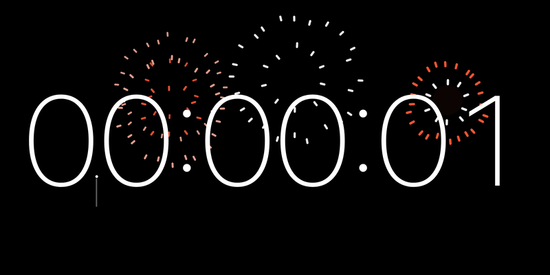

<p align="center">
  <picture>
    <source media="(prefers-color-scheme: dark)" srcset="brand/png/lockup.png">
    
  </picture>
</p>

<h3 align="center">Gives you a second chance.<br>Because some moments are special.</h3>

<p align="center">
  <a href="https://martinjsklorz.github.io/rollover/"><b>Try it in your browser</b></a>
  &nbsp;·&nbsp;
  <a href="https://github.com/martinjsklorz/rollover/actions/workflows/ci.yml"></a>
</p>

<p align="center">
  
</p>

Midnight happens once a year, and it's over in a second. The champagne pops early, the camera
isn't rolling, the kids fell asleep at ten, or you were looking at your phone when it happened.

**Rollover brings it back.** A full-screen clock that runs up to midnight, rolls over, and does it
again: 23:59:55, 00:00:00, fireworks, and once more from the top. As often as you like.

## Made for the moment

- **The take you missed.** Filming your New Year's video? Put the phone in the shot and count down
  as many times as you need. A stray tap won't stop the clock: going back takes two taps.
- **Midnight at eight.** Little ones can't stay up? Give them their countdown at bedtime,
  fireworks and all.
- **Any midnight.** A birthday, a launch, a proposal, a toast across time zones. Every big
  "now" deserves a clock that hits zero.

## Pick your midnight

| Classic | Champagne | Midnight blue, flip clock |
| :---: | :---: | :---: |
|  |  |  |
| White digits, ember fireworks | Gold digits, golden fireworks | Ice-blue split-flap cards |

Plus **Party**, in neon pink with fireworks in every color (that's the one at the top).

- **Simple or flip clock.** Thin glowing digits, or split-flap cards that flip like the real thing.
- **24-hour or 12-hour.** 23:59:59 → 00:00:00, or 11:59:59 PM → 12:00:00 AM.
- **Your timing.** 5 to 60 seconds before midnight, 5 to 60 seconds after. Then it loops.
- **Fireworks or confetti.** At the stroke of midnight, rockets go up and burst over the clock, or confetti
  pops from the corners and rains down, until the loop starts over.
- **Made for the big screen.** Full screen, the screen stays on, true black for OLED. Prop up a
  phone, or open it on the TV.

Set it up in under a minute: one question per page, with a live preview on every one.
Next time, it's one tap on Start.

**iPhone, Android and the web.** [Open it in your browser](https://martinjsklorz.github.io/rollover/), nothing to install.

---

## For developers

The first screen shows the logo and Start, which runs the clock with your last settings,
or starts the setup wizard. The first time, only the wizard is offered.

The wizard has one page per setting, with a live preview on every page:
24-hour or 12-hour, simple or flip-clock style, a theme (Classic, or the New Year's Eve themes Champagne,
Midnight blue and Party), how long before midnight and how long after it (5 to 60 s each, e.g. −5 / +10),
and the midnight animation: fireworks, confetti or none. It plays over the clock from 00:00:00 until the loop starts over.
Then the clock runs full screen on a loop: the screen stays on, the system bars are hidden,
and two taps go back to the setup (the first shows a hint, so a stray touch doesn't end a take).

Built with [Expo](https://expo.dev) (React Native) and Expo Router for iOS and Android.

```
src/app/            screens (Expo Router): index (home), setup/[step], ready, clock
src/wizard/steps.ts the wizard steps; add a setting by adding a step
src/wizard/ui.tsx   wizard page layout, option cards, buttons
src/clock/          the clock face (simple / flip), the loop timing, the midnight fireworks and confetti
src/settings.tsx    settings, defaults, saved on the device (AsyncStorage)
src/theme.ts        brand colors used by the app, and the clock themes
brand/              logo, colors, type and usage rules (brand/README.md); brand/tools builds the icons
docs/               README images (screenshots and the New Year's Eve GIF from the web build)
marketing/          App Store and Google Play screenshots; marketing/tools captures and composes them
```

### Run

```bash
corepack enable   # once; provides the pnpm version pinned in package.json
pnpm install
pnpm start        # scan the QR code with Expo Go on your iPhone or Android phone
pnpm typecheck
pnpm lint         # ESLint with eslint-config-expo (eslint.config.js)
```

Add Expo modules with `pnpm exec expo install <package>`, so the versions match the Expo SDK.

### CI and GitHub Pages

`.github/workflows/ci.yml` runs on every push and pull request: typecheck, lint, `expo-doctor`, and a
build for iOS, Android and web. Pushes to `main` publish the web build to GitHub Pages.

The web build lives under `/rollover` (`experiments.baseUrl` in `app.json`). `public/index.html` is
the page template and keeps the page black before the app loads; it links `public/manifest.json`
and the web icons with the `/rollover` prefix written out, because Expo copies `public/` as is.
The export is a single-page app, so CI copies `index.html` to one `.html` file per route
(`ready.html`, `setup/format.html`, …) and GitHub Pages answers deep links and reloads with 200.
`404.html` catches anything else.

### Builds and over-the-air updates

Store builds and OTA updates go through [EAS](https://docs.expo.dev/eas/) and need an Expo account:

```bash
pnpm dlx eas-cli@latest login
pnpm dlx eas-cli@latest init               # links the project to your account
pnpm dlx eas-cli@latest update:configure   # sets up OTA updates
pnpm dlx eas-cli@latest build              # iOS / Android builds in the cloud
pnpm dlx eas-cli@latest update             # ship JS changes to installed apps
```

OTA updates cover JavaScript and assets. A change to native code (a new native module,
a permission) needs a new store build.

`ios/` and `android/` are generated (`expo prebuild`) and not committed. Native settings live in `app.json`.
