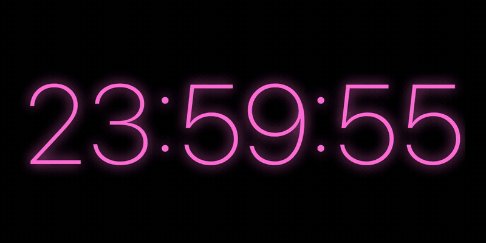
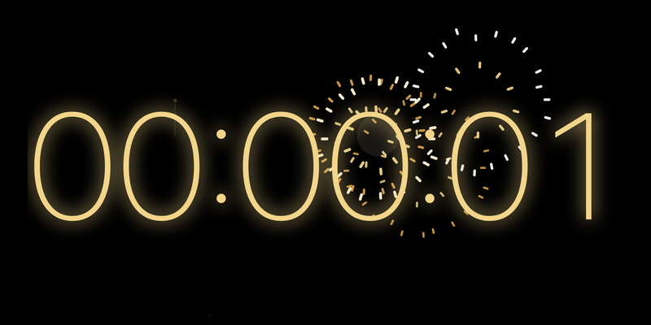
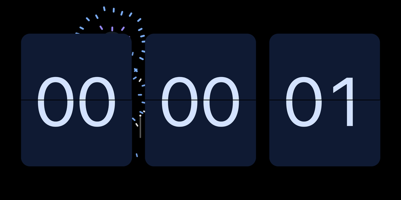

<p align="center">
  <picture>
    <source media="(prefers-color-scheme: dark)" srcset="brand/png/lockup.png">
    
  </picture>
</p>

<h3 align="center">Gives you a second chance.<br>Because some moments are special.</h3>

<p align="center">
  <a href="https://martinjsklorz.github.io/rollover/"><b>Try it in your browser</b></a>
  &nbsp;·&nbsp;
  <a href="https://github.com/martinjsklorz/rollover/actions/workflows/ci.yml"></a>
</p>

<p align="center">
  
</p>

Midnight happens once a year, and it's over in a second. The champagne pops early, the camera
isn't rolling, the kids fell asleep at ten, or you were looking at your phone when it happened.

**Rollover brings it back.** A full-screen clock that runs up to midnight, rolls over, and does it
again: 23:59:55, 00:00:00, fireworks, and once more from the top. As often as you like.

## Made for the moment

- **The take you missed.** Filming your New Year's video? Put the phone in the shot and count down
  as many times as you need. A stray tap won't stop the clock: going back takes two taps.
- **Midnight at eight.** Little ones can't stay up? Give them their countdown at bedtime,
  fireworks and all.
- **Any midnight.** A birthday, a launch, a proposal, a toast across time zones. Every big
  "now" deserves a clock that hits zero.

## Pick your midnight

| Classic | Champagne | Midnight blue, flip clock |
| :---: | :---: | :---: |
|  |  |  |
| White digits, ember fireworks | Gold digits, golden fireworks | Ice-blue split-flap cards |

Plus **Party**, in neon pink with fireworks in every color (that's the one at the top).
On New Year's Eve, "Happy New Year 2027!" fades in under the digits at midnight, always with the year that begins.

**Birthday?** Pick it as the occasion and the clock goes candy-colored (Bubblegum pink, Sky blue or
pastel Sprinkles), balloons float up at midnight, and "Happy birthday, Mia!" fades in under the digits.

**Lunar New Year?** For the Spring Festival, Seollal or Tết: red Lantern, warm Gilded gold or pink
Plum blossom digits, red paper lanterns rise at midnight, and the coming year's zodiac animal greets it:
"Happy Year of the Goat!", or 羊年大吉！

- **Your own line at midnight.** On Classic, add a short message, like "We did it!", and it fades in
  under the digits at midnight.
- **Simple or flip clock.** Thin glowing digits, or split-flap cards that flip like the real thing.
- **24-hour or 12-hour.** 23:59:59 → 00:00:00, or 11:59:59 PM → 12:00:00 AM (午後11:59:59, 오후 11:59:59 …),
  starting from the way your phone shows the time.
- **Your timing.** 5 to 60 seconds before midnight, 5 to 60 seconds after. Then it loops.
- **Fireworks, confetti, balloons or lanterns.** At the stroke of midnight, rockets go up and burst over the clock,
  confetti pops from the corners and rains down, or balloons or lanterns float up, until the loop starts over.
- **A music box, if you like.** Off unless you turn it on: at 00:00:00 a music box plays the Westminster
  chimes, "Auld Lang Syne", "Happy Birthday" or "Jasmine Flower", depending on the occasion. It plays alongside
  your party music instead of stopping it, and through the TV's speakers on a TV.
- **In your language.** English, Chinese, Spanish, Hindi, Portuguese, French, German, Japanese, Russian,
  Korean, Indonesian, Turkish, Italian, Polish, Ukrainian and Dutch, following your phone or browser.
- **Made for the big screen.** Full screen, the screen stays on, true black for OLED. Prop up a
  phone, or run it on the TV: there's an app for Apple TV and Android TV (Google TV), driven by the remote.

Set it up in under a minute: one question per page, with a live preview on every one.
Next time, it's one tap on Start.

**iPhone, Android, Apple TV, Android TV and the web.** [Open it in your browser](https://martinjsklorz.github.io/rollover/), nothing to install.

---

## For developers

The first screen shows the logo and Start, which runs the clock with your last settings,
or starts the setup wizard. The first time, only the wizard is offered.

The wizard has one page per setting, with a live preview on every page. It starts with the occasion
(`src/occasions.ts`), which decides the pages and options that follow:

| Occasion | Themes | Animations (first is the default) | Extra |
| --- | --- | --- | --- |
| Classic | Classic only, so no theme page | fireworks, confetti, none | an optional message page; the message shows under the clock at midnight |
| New Year's Eve | Champagne, Midnight blue, Party | fireworks, confetti, none | "Happy New Year 2027!" under the clock at midnight (the year that begins) |
| Birthday | Bubblegum, Sky, Sprinkles | balloons, confetti, none | a name page; "Happy birthday, Mia!" under the clock at midnight |
| Lunar New Year | Lantern, Gilded, Plum blossom | lanterns, fireworks, confetti, none | "Happy Year of the Goat!" under the clock at midnight (the coming year's zodiac animal) |

Then: 24-hour or 12-hour (the first time, preset to the device's choice), simple or flip-clock style, the theme,
how long before midnight and how long after it (5 to 60 s each, e.g. −5 / +10), the midnight animation, and the
sound. The animation plays over the clock from 00:00:00 until the loop starts over; the sound is the occasion's
music box tune, once at 00:00:00 (see [Sound](#sound)), or silence.
Then the clock runs full screen on a loop: the screen stays on, the system bars are hidden,
and two taps go back to the setup (the first shows a hint, so a stray touch doesn't end a take).
On a TV, Select works like a tap and the remote's Back button goes back right away.

Built with [Expo](https://expo.dev) (React Native) and Expo Router for iOS and Android, and for
Apple TV and Android TV with [react-native-tvos](https://github.com/react-native-tvos/react-native-tvos)
(see [TV](#tv)).

```
src/app/            screens (Expo Router): index (home), setup/[step], ready, clock
src/wizard/steps.ts the wizard steps; add a setting by adding a step
src/occasions.ts    Classic, New Year's Eve, Birthday, Lunar New Year: the themes and animations each one offers
src/wizard/ui.tsx   wizard page layout, option cards, buttons
src/clock/          the clock face (simple / flip), the loop timing, the greeting at midnight, the midnight
                    fireworks, confetti, balloons and lanterns
src/settings.tsx    settings, defaults, saved on the device (AsyncStorage)
src/sound.ts        the music box: one tune per occasion, played at 00:00:00 on the full-screen clock
src/theme.ts        brand colors used by the app, and the clock themes
src/i18n/           the app's languages (one file each, translated from languages/en.ts) and the device-language pick
src/tv.ts           TV helpers: sizes doubled on Apple TV, the remote's Back button, overscan margins
brand/              logo, colors, type and usage rules (brand/README.md); brand/tools builds the icons
docs/               README images (screenshots and the New Year's Eve GIF from the web build)
tools/musicbox/     renders the music box tunes into assets/sounds/ (see Sound)
marketing/          App Store and Google Play screenshots; marketing/tools captures and composes them
```

### Run

```bash
corepack enable   # once; provides the pnpm version pinned in package.json
pnpm install
pnpm start        # scan the QR code with Expo Go on your iPhone or Android phone
pnpm typecheck
pnpm lint         # ESLint with eslint-config-expo (eslint.config.js)
```

Add Expo modules with `pnpm exec expo install <package>`, so the versions match the Expo SDK.

### CI and GitHub Pages

`.github/workflows/ci.yml` runs on every pull request and every push to `main`: typecheck, lint, `expo-doctor` and a
TV prebuild (which checks the TV config and artwork in `app.json`). Pushes to `main` also build iOS, Android and web. They publish the web build to GitHub Pages.

The web build lives under `/rollover` (`experiments.baseUrl` in `app.json`). `public/index.html` is
the page template and keeps the page black before the app loads; it links `public/manifest.json`
and the web icons with the `/rollover` prefix written out, because Expo copies `public/` as is.
The export is a single-page app, so CI copies `index.html` to one `.html` file per route
(`ready.html`, `setup/format.html`, …) and GitHub Pages answers deep links and reloads with 200.
`404.html` catches anything else.

### Builds and over-the-air updates

Store builds and OTA updates go through [EAS](https://docs.expo.dev/eas/) and need an Expo account:

```bash
pnpm dlx eas-cli@latest login
pnpm dlx eas-cli@latest init               # links the project to your account
pnpm dlx eas-cli@latest update:configure   # sets up OTA updates
pnpm dlx eas-cli@latest build              # iOS / Android builds in the cloud
pnpm dlx eas-cli@latest update             # ship JS changes to installed apps
```

OTA updates cover JavaScript and assets. A change to native code (a new native module,
a permission) needs a new store build. The sound (`expo-audio`, a native module) is one: builds made before it
can't get it over the air, so ship it with a new store build, and use a new development build
(`pnpm exec expo run:ios|android`, or `pnpm dlx eas-cli@latest build --profile development`) to try it.
Expo Go already includes `expo-audio`.

`ios/` and `android/` are generated (`expo prebuild`) and not committed. Native settings live in `app.json`.

### Sound

The only sound is a music box, once at 00:00:00, and it's off by default (`sound: 'musicbox' | 'off'`).
Each occasion has its tune, all traditional melodies in the public domain. Only the melody is used,
never lyrics or someone else's recording:

| Occasion | Tune | Public domain |
| --- | --- | --- |
| Classic | The Westminster Quarters, the full-hour chime | Written in 1793 for Great St Mary's, Cambridge ([Wikipedia](https://en.wikipedia.org/wiki/Westminster_Quarters)) |
| New Year's Eve | "Auld Lang Syne", the first phrase | Traditional Scots melody, the standard tune since George Thomson's *Select Songs of Scotland*, 1799 ([Wikipedia](https://en.wikipedia.org/wiki/Auld_Lang_Syne)) |
| Birthday | "Happy Birthday to You" | Melody of "Good Morning to All" (Hill sisters, 1893). Declared public domain in the US in 2016 (*Marya v. Warner/Chappell*); expired in the EU on 1 January 2017 ([Wikipedia](https://en.wikipedia.org/wiki/Happy_Birthday_to_You)) |
| Lunar New Year | "Mo Li Hua" (Jasmine Flower), the first verse (its repeated opening line played once) | Traditional Chinese folk song, first printed in the West in John Barrow's *Travels in China*, 1804 ([Wikipedia](https://en.wikipedia.org/wiki/Mo_Li_Hua)) |

`tools/musicbox/musicbox.py` holds the melodies as note data and renders them with the Python standard library
(no packages): each tine is a decaying sum of a steel beam's inharmonic partials, struck by a pin's knock 10 ms
before the tone, panned by pitch, in a small box-and-room reverb, and never exact, like a real one: every tine is
a few cents out of tune (always the same tine, the same amount), a hard pluck starts a little sharp and settles,
pins strike up to 16 ms early or late, the cylinder's speed wobbles with its governor and slows as the spring
runs down, and the touch varies. All of it plays over a quiet clockwork whirr that winds down after the last
note. Happy Birthday has a waltz accompaniment; the other tunes are the melody alone. It writes
`assets/sounds/<occasion>.wav`, 16-bit stereo at 44.1 kHz, peak −0.9 dBFS, the silent tail trimmed.
Change a tune or the sound there, then rebuild the files (needs `python3`):

```bash
pnpm sounds
```

`src/sound.ts` plays them with `expo-audio`:

- **When.** On the tick the clock shows 00:00:00, when the midnight animation starts. If the loop starts over
  before the tune ends, it fades out over 300 ms. It stops when you leave the clock or the app goes to the
  background. The wizard preview is always silent; picking Music box on the sound page plays the tune once.
- **With other audio.** It mixes with music that's already playing (`interruptionMode: 'mixWithOthers'`),
  plays with the iPhone's silent switch on (the user turned it on), and never plays in the background.
- **Permissions.** The `expo-audio` plugin in `app.json` turns off its defaults for recording and background
  playback, so there's no microphone permission (`NSMicrophoneUsageDescription`, `RECORD_AUDIO`) and no
  background audio mode or service.
- **Web.** Browsers only let a page start sound after a tap, and Safari on iPhone asks it of each audio element.
  Start (on the home screen and the last wizard page) unlocks the player inside the tap, before going
  full screen, which would use the tap up. A clock opened directly by its URL stays silent.
- **TV.** `expo-audio` supports tvOS and Android TV, so the tune plays through the TV's speakers.

### TV

`react-native` in `package.json` is [react-native-tvos](https://github.com/react-native-tvos/react-native-tvos),
a fork of React Native that also builds for Apple TV and Android TV. It builds phone apps the same as
React Native. The `@react-native-tvos/config-tv` plugin in `app.json` makes `expo prebuild` generate TV
projects when `EXPO_TV=1` is set, so one native project is either phone or TV, never both:

```bash
pnpm tv:ios       # prebuild for Apple TV, then run it in the Apple TV simulator
pnpm tv:android   # prebuild for Android TV, then run it on an Android TV emulator (API 31+)
pnpm exec expo prebuild --clean   # back to phone projects
```

Prebuild changes the `ios` and `android` scripts in `package.json` to `expo run:*`; don't commit that.
Expo Go doesn't run on a TV, so TV apps are always development builds.

- **Remote.** Every screen sets where the remote's focus starts (`hasTVPreferredFocus`), and buttons and
  options show the focus (white fill, white outline). The remote's Back button goes back; on the home
  screen it leaves the app, as Apple TV requires.
- **Sizes.** Android TV lays out at 960×540 dp, like a phone on its side. Apple TV lays out at 1920×1080
  points, so there `sizedStyles` doubles every size and `useScreenSize` halves the window (`src/tv.ts`).
- **Artwork.** `brand/tools` builds the Android TV banner and the Apple TV layered icon and top shelf
  images into `assets/tv/`. Apple checks the sizes exactly.
- **Builds.** `eas.json` has a `_tv` profile for each build profile (`EXPO_TV=1`):
  `pnpm dlx eas-cli@latest build --profile production_tv`. Apple TV uses the iPhone app's bundle ID and
  certificate but needs its own tvOS provisioning profile, which EAS can't create: make it in the Apple
  Developer portal and use [local credentials](https://docs.expo.dev/app-signing/local-credentials/).
- **Samsung (Tizen) and LG (webOS)** TVs aren't supported by React Native; their browsers run the web version.
