# Rollover brand

Black screen, white digits, and one moment in orange: midnight.

## The mark



A ring with a gap at 12 o'clock, and a dot in the gap.
The ring is the loop the clock runs. The dot is midnight, where the day rolls over.

All marks are generated by `tools/build.mjs` from one geometry. Proportions, relative to the ring radius `r`:

| Part | Size |
| --- | --- |
| Ring stroke | 0.14 r (0.19 r in the lockup, to match the type) |
| Dot radius | 0.95 × stroke |
| Gap between each ring end and the dot | 0.75 × stroke |
| Line ends | round |

Leave clear space around the mark of at least the ring radius `r`.
The mark should be at least 16 px wide. Below that, use the mono version.

## Files

| File | Use |
| --- | --- |
| `logo/mark.svg` | Mark on dark backgrounds (default) |
| `logo/mark-on-light.svg` | Mark on light backgrounds |
| `logo/mark-mono-white.svg`, `logo/mark-mono-black.svg` | One color: small sizes, print, embossing |
| `logo/lockup.svg`, `logo/lockup-on-light.svg` | Mark + wordmark |
| `logo/wordmark.svg`, `logo/wordmark-on-light.svg` | Wordmark alone |
| `png/` | 1024 px PNG exports of the above |
| `social/og-1200x630.png` | Link preview (Open Graph) |
| `social/banner-1024x500.png` | Play Store feature graphic |
| `social/square-1080.png` | Social posts, profile images |

App icons and the splash image live in `../assets/` and are wired up in `app.json`:
`icon.png` (iOS, plus `icon-dark.png` and `icon-tinted.png` for iOS 18 dark and tinted icons),
`android-icon.png` and `android-icon-monochrome.png` (adaptive and themed icons), `splash-icon.png`.

## Color

| Name | Hex | Use |
| --- | --- | --- |
| Black | `#000000` | Background, always. True black so OLED screens switch the pixels off. |
| White | `#FFFFFF` | Digits, the ring, primary text, the primary button. |
| Ember | `#FF5A36` | Midnight. The dot in the mark, the selected choice in the app. **One ember element per screen, at most.** |
| Gray | `#8E8E93` | Secondary text, hints, the Back button. |
| Graphite | `#1C1C1E` | Pressed rows, flip-clock cards. |
| Line | `#2C2C2E` | Hairlines, borders, empty radio circles. |
| Paper | `#F4F3EF` | Light background for print and documents, never in the app. |

The same values are in `src/theme.ts`.

## Type

- **Wordmark:** `rollover`, lowercase, Inter Light (300), tracking −2 %. Outlined in the SVGs, so no font is needed to use them.
- **In the app:** the system font (SF Pro on iOS, Roboto on Android). Clock digits Thin (100) with tabular figures. Titles Light (300). Body Regular.
- **Marketing and documents:** Inter. Light for large headlines, Regular for text.

## Voice

Short and plain. Say what happens: "Place your phone, then tap Start."
Tagline: **Midnight, again and again.**

## Don't

- No glow, no gradients, no shadows. Flat shapes on black.
- Don't recolor the ring. Only the dot is ember.
- Don't use ember for anything other than midnight or the current selection.
- Don't rotate the mark. The gap is always at 12 o'clock.
- Don't put the mark on a busy photo. Use black, white or paper behind it.

## Rebuild

```bash
cd brand/tools
pnpm install --ignore-workspace
pnpm build
```

This rewrites `logo/`, `png/`, `social/` and the icons in `../assets/`. Change the geometry or colors in `build.mjs`, not in the output files.
